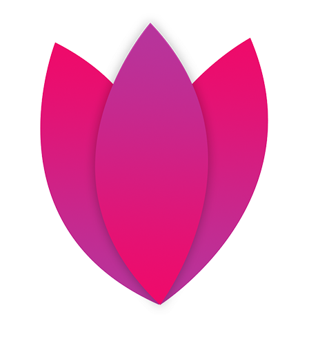
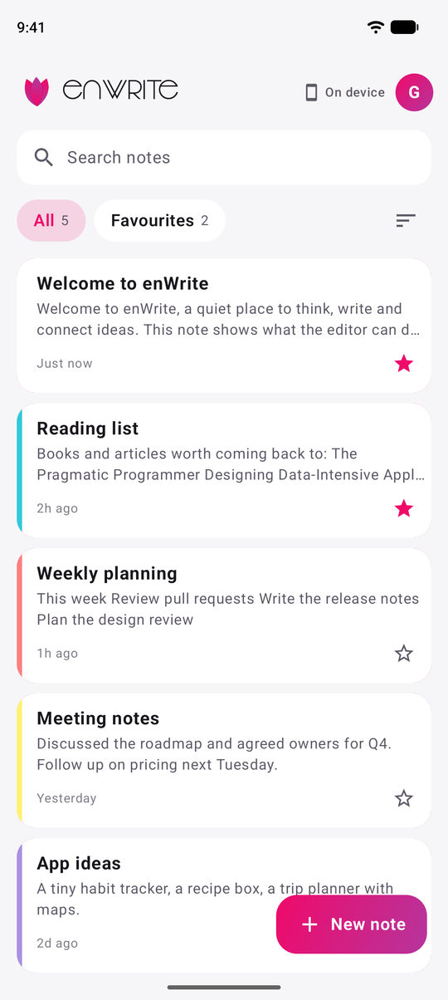
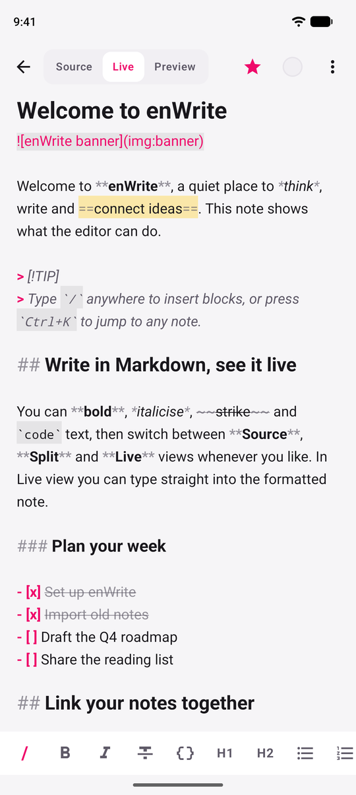
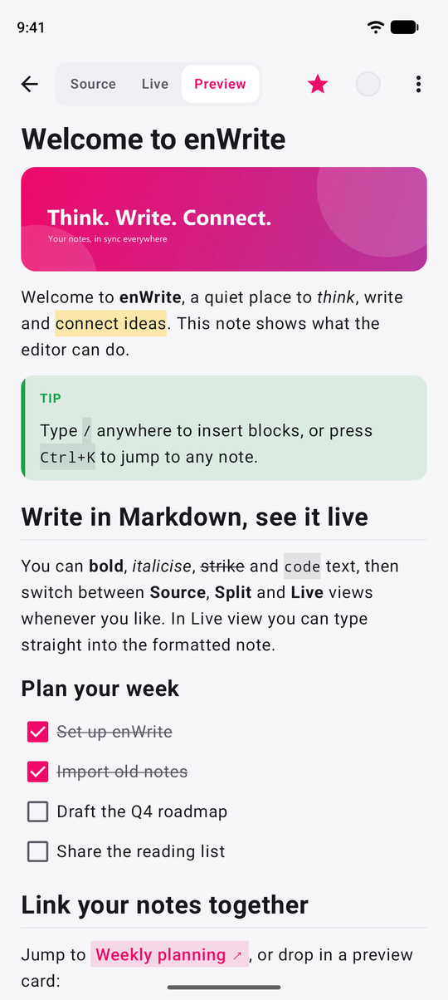
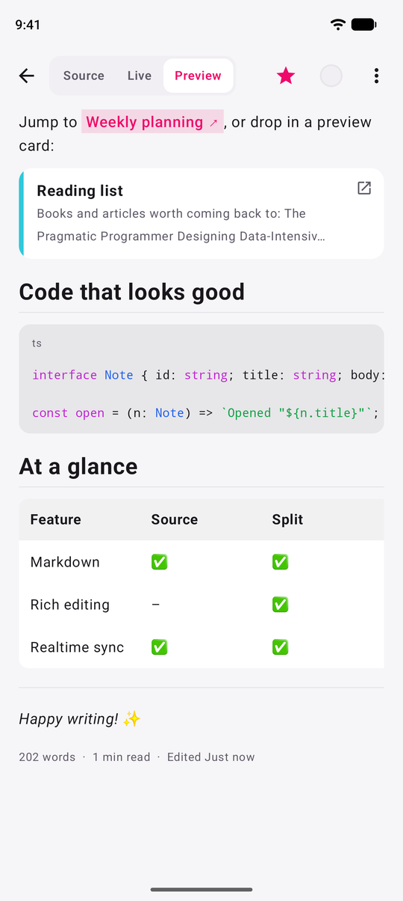
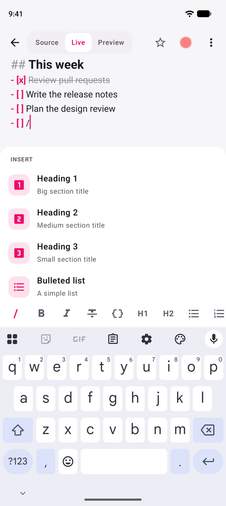
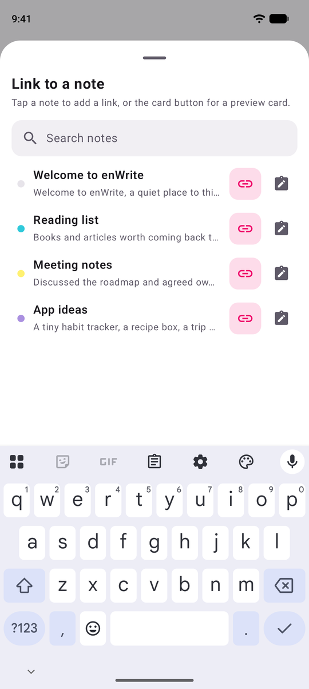
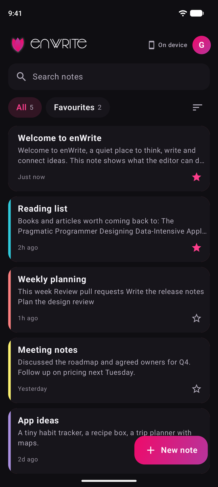
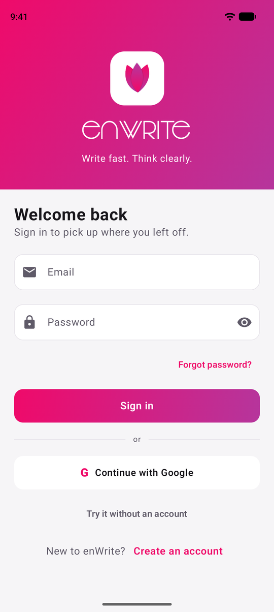
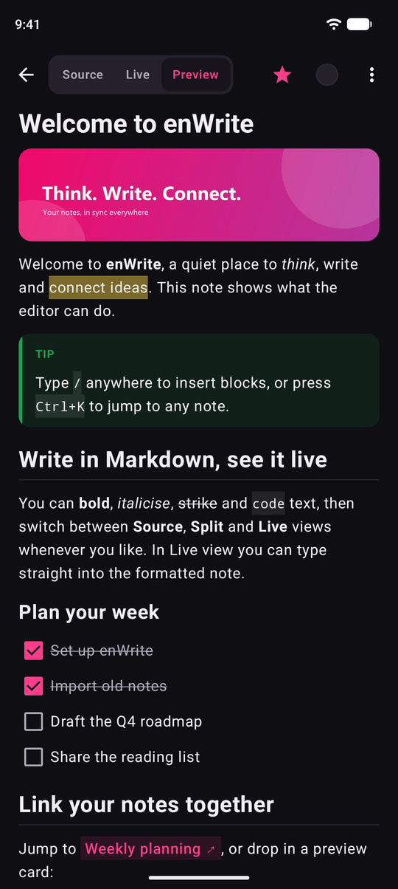

<div align="center">



# enWrite for Android

**A fast, minimal note-taking app that syncs with the enWrite web and desktop apps.**<br/>
Native Kotlin and Jetpack Compose, built for touch.

</div>

<p align="center">
  
  
  
</p>

- **Package:** `com.srvraj311` · **Min SDK:** 24 (Android 7.0) · **Target SDK:** 36 · **Compile SDK:** 37
- **Backend:** Firebase project `enwrite-web` (Auth + Firestore), the same one the web app uses. Notes live at `users/{email}/note/{id}`, so every enWrite app shares them.

## Features

- **Sign in** with email and password, Google (Credential Manager), password reset, or try the app as a guest (notes stay on the device).
- **Notes list** with search, favourites, sort by time, title or colour, note colours, swipe to delete and a sync status chip.
- **Three ways to write:** Source (raw Markdown), Live (the Markdown styled as you type, markers dimmed) and Preview (rendered, with tappable checkboxes).
- **Formatting toolbar** above the keyboard: bold, italic, strikethrough, code, headings, lists, checklist, quote, code block, link, note link, image.
- **`/` insert menu** for headings, lists, checklist, quote, callout, code block, table, divider, note link, note card, image, web link, highlight and today's date.
- **Link notes together** with link chips or preview cards (`[Title](enwrite://note/<id> "card")`), compatible with the web app.
- **Rich rendering:** callouts (`> [!NOTE]`), `==highlights==`, tables, strikethrough and syntax-highlighted code.
- **Images:** pick from the gallery; images are shrunk and saved with the note (`img:<id>`). Tap one to open a full-screen viewer with pinch to zoom and a Download button.
- **Export:** save as Markdown, save as PDF (system print dialog) or share.
- **Realtime sync** with an offline cache. The status chip shows Synced, Syncing or Offline, and signing out saves your last edit and warns if changes are still unsynced.
- **Light, dark and system themes**, edge to edge, with a side-by-side layout on tablets.

## Screenshots

| Preview | Links, code and tables | Slash menu |
| :---: | :---: | :---: |
|  |  |  |

| Link to a note | Dark theme | Sign in |
| :---: | :---: | :---: |
|  |  |  |

<p align="center">
  
</p>

## Build

Requirements: Android Studio (or JDK 17+ and the Android SDK with platform 37), then:

```sh
./gradlew :app:assembleDebug        # debug APK
./gradlew :app:installDebug         # install on a connected device or emulator
```

### Release build

Create `keystore.properties` in the project root (it is git-ignored, never commit it):

```properties
storeFile=C:/path/to/your-keystore.jks
storePassword=...
keyAlias=your-alias
keyPassword=...
```

Then build the shrunk, signed release:

```sh
./gradlew :app:assembleRelease      # app/build/outputs/apk/release/app-release.apk
./gradlew :app:bundleRelease        # app/build/outputs/bundle/release/app-release.aab
```

Raise `versionCode` and `versionName` in `app/build.gradle.kts` for each new release.

## Project layout

```
app/src/main/java/com/srvraj311/
  data/        Note model, Firestore repository, auth, settings
  ui/          app root, home list, auth, settings
  ui/editor/   editor, Markdown renderer, live styling, slash menu, images, export
```

## Tech

Kotlin 2.4 · Jetpack Compose (Material 3) · Android Gradle Plugin 9.4 · Firebase Auth and Firestore · Credential Manager · CommonMark (rendering) · Coil (images) · DataStore (settings).

---

## Before v2: the original app

enWrite started in 2021 as a simple Java app, and this project is its complete rewrite. This is what the original release looked like and offered.

> enWrite is a simple and clean app for taking notes on the go and setting reminders for important tasks.
>
> - Note taking and real-time cloud backup
> - Reminders and alarms with a stylish date picker
> - Cross browser and platform support
>
> **Later additions:** a new display UI for saved notes, local synchronization for offline use, and a colour picker when creating a note.

<p align="center">
  
  
  
  
</p>

### What changed in v2

| | Original (v1) | v2 |
| --- | --- | --- |
| Language and UI | Java, XML layouts, Android Views | Kotlin, Jetpack Compose |
| Notes | Plain text with colours | Markdown with Source, Live and Preview modes, `/` menu, note links and cards, images |
| Cloud sync | Firestore, one-off reads | Realtime listeners, offline cache, sync status, safe sign-out |
| Backend | Firebase project `enwrite-8ffba` | Shared `enwrite-web` project, so notes sync with the web and desktop apps |
| Colours and favourites | Colour picker, pin and unpin | Colour picker, favourites, search and sorting |
| Reminders and alarms | Yes | Not carried over yet |
| Themes | Light and dark | Light, dark and system, with an in-app switch |
| Build | Gradle 6.5, SDK 30 | Gradle 9.6, SDK 37 |
